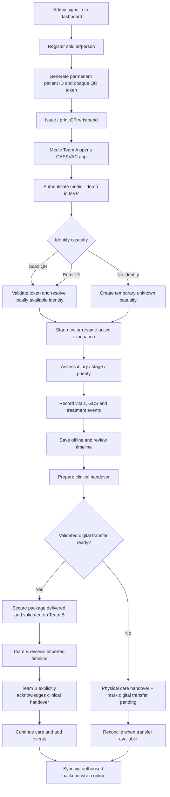
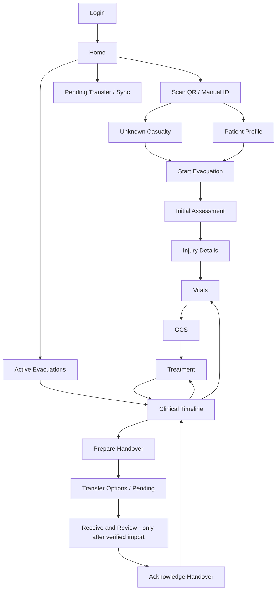

# CASEVAC — Application Flow

**Scope:** QR-first medic Android app, basic registration dashboard, Point A → Point B.  
**Key rule:** the patient QR is *identity only*. Cross-phone treatment history requires a separate validated transfer or previously synced cache.

## 1. Cross-system overview



## 2. Admin registration flow

```text
Admin Sign In
  → Personnel Directory
  → Register Soldier
  → Validate required fields
  → Generate random, unique Patient ID
  → Generate random opaque QR token
  → Save Patient + QR assignment in backend
  → Show printable QR / wristband label
  → Mark as Issued after physical assignment
```

The QR token must not contain name, service number, address, medical history or live incident details by default. Handle reissue by rotating/revoking old token. A QR generation UI alone does not automatically provision offline phones with the mapping; controlled patient directory caching must be designed.

## 3. Medic mobile navigation map



## 4. Point A workflow (offline)

1. Medic opens app and passes the available approved/demo authentication step.
2. Scan existing wristband QR. The app decodes a random token, then looks for a matching identity **in local cache** or server (when online).
3. If identity is unavailable, do **not** invent a matched soldier. Offer manual verification, unknown casualty or pending-identity status.
4. Create an incident ID independent of the person identity.
5. Capture assessment, injury, priority, vitals, GCS and care events; save each to encrypted local storage target.
6. Attach observed time, recorded time, clinician identifier, source device and event ID to entries.
7. Continue documenting during transit. Avoid overwriting earlier care; use an auditable correction workflow.

## 5. Handover workflow (Point B)

1. Team A reviews active incident, treatment timeline, latest observations and intended receiver.
2. Tap **Prepare Handover**; save a snapshot/summary locally with status `PREPARED`.
3. Choose an available *implemented, authorised* mode: server, verified Bluetooth, Wi-Fi Direct or USB. Unimplemented modes must not behave as if they succeeded.
4. If no transfer is possible, hand over clinically through required verbal/paper procedure and mark `DIGITAL_TRANSFER_PENDING`.
5. Team B must **actually receive/import** the protected payload on its device before the app shows prior offline care.
6. Receiving clinician reviews casualty and incident identifiers, import validation, record version and incoming history.
7. Receiving clinician acknowledges handover **separately from data transfer**, then may append new events.
8. Pending events are reconciled when approved connectivity or a working direct transfer becomes available.

### Status definitions

| Status | Meaning | Never confuse with |
| --- | --- | --- |
| `SAVED_LOCAL` | Clinical event committed on this device | Saved on another phone |
| `HANDOVER_PREPARED` | Summary generated and saved | Data delivered |
| `DIGITAL_TRANSFER_PENDING` | No verified import at recipient yet | Clinician informed verbally |
| `DIGITAL_TRANSFER_SENT` | Sending channel reported send | Recipient accepted/validated |
| `DIGITAL_RECORD_RECEIVED` | Recipient validated and imported package | Clinical acknowledgement |
| `CLINICAL_HANDOVER_ACKNOWLEDGED` | Authorised recipient explicitly acknowledged | Upload/sync complete |
| `SYNCED` | Server has accepted/reconciled events | Proof of bedside handover |

## 6. Authentication and access

- Admin dashboard registers verified/approved identities under a client-governed process.
- Medic app supports role-aware access; temporary demo login must be visibly labelled.
- Biometric or MPIN may unlock a previously provisioned authorised device/session but is not evidence of professional registration.
- Offline access, expired credentials, revoked users and lost devices need a formally approved policy before deployment.

## 7. Exceptional cases

| Case | Flow |
| --- | --- |
| QR damaged / no wristband | Manual ID or temporary Unknown Casualty record |
| Scanned token not cached and offline | Show `Identity unavailable offline`; don't fabricate a record |
| Wrong/mismatched patient | Stop and require reassessment; do not merge automatically |
| Multiple incidents for one patient | Show incident list and choose correct active incident |
| Lost phone / app restart | Reopen committed records from local storage where available |
| Direct transfer unavailable | Preserve patient care, handover verbally/on paper, digital pending |
| Duplicate imported event | Reject duplicate Event ID; preserve audit |
| Interrupted transfer | Keep pending; permit retry with validation |
| Unauthorised recipient | Do not reveal protected clinical contents |

## 8. Client reference mapping

- AFMSF-21 pp.1–4 inform the **clinical entry** screens, not the QR content.
- General 9-Line MEDEVAC can be a *separate* evacuation request branch, if added later.
- Future RFID may replace the identification scan mechanism; it does not automatically make every NFC wristband capable of carrying all clinical records.
