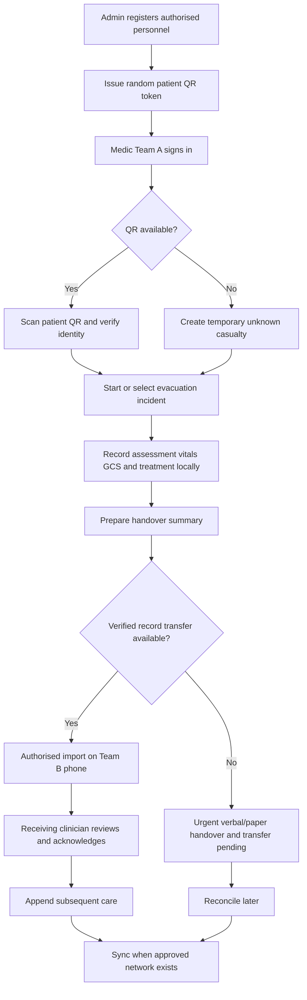

# CASEVAC — Project Overview

**Project:** Digital Evacuation Program (CASEVAC) · **App name:** Jeevan  
**Focus:** Point A → Point B casualty documentation and clinical handover  
**Current implementation direction:** QR-based identification; offline-first **Android tablet app, landscape-first with portrait support**; lightweight web admin  
**Client UI update (12 Nov 2026):** tablet-first, landscape-only, operational dashboard UI — see `UI_DESIGN_GUIDELINES.md` v2  
**Status:** Client-review baseline, not deployment approval

## 1. Problem statement

In pre-hospital evacuation, information about a casualty can be fragmented between handwritten notes, verbal reports, different medical teams and disconnected devices. Medics need a structured way to preserve who administered which treatment, what was observed, and what information reached the receiving team. The environment may have no cellular coverage and may not permit normal network connectivity.

## 2. Proposed solution

Build a **React Native Android tablet application — "Jeevan"**, used in landscape on ~10-inch tablets — for verified medics to document an ongoing evacuation, backed by a basic web admin dashboard for personnel enrolment and issuing unique patient QR wristbands. The app opens on a **command dashboard** (casualty summary cards, company-wise and triage-category charts, recent activity, quick actions).

- **Admin** verifies/registers personnel, generates a random permanent Patient ID and issues an associated QR token.
- **Medic Team A** authenticates, scans QR (or uses a safe unknown-casualty process), creates a new evacuation incident and records initial care offline.
- **During transit** clinicians append time-stamped injury, vital, neurological and medication/intervention entries.
- **At Point B** Team B receives a clinical summary through a *verified* transfer mode when available, reviews the imported record and acknowledges handover.
- **When transfer is unavailable** the care handover must not be delayed; the app keeps digital transfer pending for later reconciliation.
- **Online** approved central services can receive and reconcile records when allowed connectivity returns.

## 3. In scope / out of scope

| In scope | Not part of current QR-first MVP |
| --- | --- |
| Soldier and medic registration (basic dashboard) | Full inpatient/hospital care management dashboard |
| Permanent QR identification token | Clinical history stored inside static patient QR |
| Distinct evacuation incident per injury/episode | Unlimited automatic sharing across disconnected devices |
| Offline assessment, vitals, GCS and treatment logging | Production clinical decision support/AI diagnosis |
| Timeline and prepared handover summary | Real-time GPS tracking or tactical command systems |
| Home command dashboard (counts and charts from records on the tablet) | Force-wide live totals before server sync exists |
| Triage category (RED / YELLOW / GREEN / BLACK) and company per casualty | Phone-sized portrait layouts |
| Future-looking offline transfer interfaces | Guaranteed Bluetooth/Wi-Fi Direct/USB transfer without testing |
| Unknown casualty and manual-ID fallback | Operational deployment with real protected patient data |
| Future NFC/RFID-ready identity abstraction | RFID tag writing without suitable chip/readers |

## 4. Users and responsibilities

| User | Responsibilities | Permissions (MVP design) |
| --- | --- | --- |
| Admin / registrar | Register personnel, issue/revoke QR wristbands, manage users | Identity management; no routine clinical edits |
| Medic / clinician | Identify casualty, start incident, add care entries | Authenticated, attributed entries within authorised scope |
| Receiving medic | Validate patient and received history; append care and acknowledge | Must have imported/shared history; scan alone is insufficient |
| Optional receiving hospital viewer | Review authorised handover record | Future client-approved read-only access |

Authentication roles and enrolment policies require client approval. Phone biometric unlock is **not** a substitute for verifying the clinician's credentials.

## 5. Patient/incident concepts

**Person / Patient ID** identifies an enrolled individual over time. **QR token** is a random opaque value presented on a wristband and mapped to that person. **Evacuation ID** identifies one distinct injury/evacuation; a patient may have many incidents. **Clinical Event ID** identifies one entry in the timeline. **Handover ID** identifies a transfer/receipt transaction, not a person.

Example (fictional):

```text
Person: PAT-DEMO-001
QR token: qr_demo_7a6d...   (opaque sample; actual tokens random)
Evacuation: EVAC-DEMO-2026-001
Events: EVT-001 (vitals), EVT-002 (medication), EVT-003 (handover note)
```

## 6. End-to-end concept



## 7. Reference documents and their role

- **AFMSF-21 Revised, pages 1–4:** reference for identity/history, initial priorities, tourniquet times, front/back injury diagrams, repeated temperature/pulse/BP/respiration/SpO2, GCS eye/verbal/motor, drug/IV-fluid documentation and care-stage attribution.
- **General 9-Line MEDEVAC image:** reference for a *separate evacuation request* (pickup location, communications, priority, equipment, casualty classifications, pickup security/marking, nationality/status, hazard/terrain). Inclusion in the MVP needs confirmation; operational fields should not automatically go on a patient wristband.
- **Earlier client document pack (4 November 2026):** draft, not production sign-off; emphasizes separate person/incident records, offline local data, attributable clinical events, and explicit digital-transfer status.

The AFMSF-21 form uses stage labels such as RAP/ADS and FAC/FSC in different sections. Confirm meanings and preferred digital mapping with the client/clinical team rather than guessing.

## 8. Desired outcomes / prototype success

1. Register fictional Soldier A; issue/print a QR token.
2. On Android, scan or enter the token and display the correct identity when it is provisioned/cached.
3. Create a fresh incident, enter several time-stamped treatment and vital events, and recover them after restarting offline.
4. Display patient/incident mismatch warnings; never silently merge different patients.
5. Prepare a clear clinical summary and distinguish **saved**, **transfer pending**, **received**, and **clinically acknowledged**.
6. If a transfer method is implemented, verify it between *two* authorised phones with simulated data and test failed transfers.

## 9. Risks, assumptions and open decisions

- **Offline identity lookup:** dashboard data must be provisioned/cached to the phone ahead of time; scanning a QR is not an offline server lookup.
- **Transfer method:** Bluetooth, Wi-Fi Direct and USB are candidates. Choose only after feasibility and security validation; any untested method stays a mock UI.
- **Encryption:** local storage and clinical transfer require production-grade key handling; prototype convenience must not be confused with operational security.
- **Data volume:** long notes/photos may prevent compact direct transfer over some methods; photo inclusion is not a day-3 requirement.
- **Clinical rules:** mandatory fields, priorities, stages, scoring and signature rules require clinical review.
- **Security approval:** devices, radios, network services and personnel records require client policy confirmation.
- **Orientation:** since 13 Nov 2026 the app supports both landscape and portrait with no orientation lock (Android 16+ ignores locks on tablets anyway). If the client needs strict landscape, it must come from device management.
- **Dashboard scope:** without server sync, dashboard figures cover only records on the tablet showing them.

## 10. Success definition for the 2–3-day sprint

A coherent **basic demonstration** with registration/QR, app screens, local synthetic clinical entries and handover summary. Hardware-dependent secure two-device offline transfer, complete backend deployment and operational accreditation are **separate follow-up milestones**.
